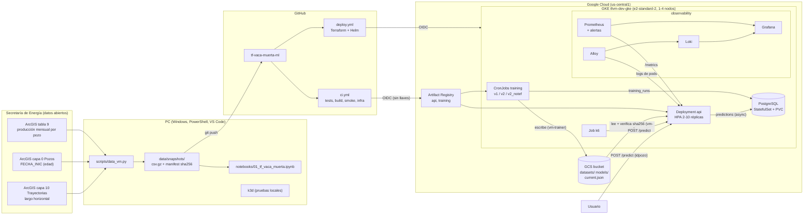

# Arquitectura

## Diagrama

## Componentes

| Componente | Implementación | Responsabilidad |
|---|---|---|
| Datos | `scripts/data_vm.py`, `vm_ml/data.py` | Descarga del ArcGIS, snapshot reproducible (sha256), edad del pozo y largo horizontal |
| Modelo | `vm_ml/features.py` | Pipeline scikit-learn (imputación, escalado, one-hot, `DecisionTreeRegressor`) en un solo artefacto |
| Entrenamiento | `training/train.py` (imagen `training`, CronJob) | Valida, entrena, compara contra la vigente, versiona y registra |
| Registro de modelos | `vm_ml/registry.py` + bucket | `models/<m>/<versión>/{model.joblib,metadata.json}` y `current.json` |
| API de inferencia | `api/` (FastAPI, imagen `api`) | `/predict`, `/healthz`, `/metrics`, consultas de modelos y pozos |
| Base de datos | PostgreSQL (StatefulSet) | `training_runs`, `predictions` |
| Infraestructura | `terraform/` | Red, GKE, Artifact Registry, bucket, cuentas de servicio y Workload Identity |
| CI/CD | `.github/workflows/` | Tests, build, publicación y despliegue por OIDC |
| Observabilidad | `observability/` | Prometheus, Grafana, Loki/Alloy, 5 alertas, dashboard |
| Carga | `loadtest/` | k6 como Job dentro del cluster |

## Decisiones de diseño

**1. El modelo no va dentro de la imagen.** El template entrenaba Iris en el `docker build`. Acá el entrenamiento es un servicio aparte y la API descarga la versión vigente del bucket al arrancar. Así, entrenar y promover una versión no requiere reconstruir ni redesplegar la imagen, y cada versión queda trazable a su dataset (id + sha256), sus hiperparámetros y su separación.

**2. Versiones inmutables + puntero.** Cada entrenamiento escribe una carpeta nueva; solo `current.json` cambia. Volver atrás es reescribir el puntero. El bucket tiene versionado de objetos.

**3. Comparación justa entre versiones** (punto 4 de la devolución). El holdout se define por `sha256(salt:idpozo) % 100 < 20`: no depende de semillas ni del orden de las filas, es el mismo para todas las versiones y un pozo nuevo cae siempre del mismo lado. La versión vigente se **re-evalúa** sobre ese holdout con el dataset actual. Se promueve solo si el MAE mejora ≥ 1 % y el intervalo bootstrap al 90 % (remuestreo de pozos, pareado) de la mejora excluye el cero.

**4. Tres versiones con usos distintos** (punto 2). `v1` reproduce la propuesta; `v2` reemplaza el mes del año por la edad del pozo y suma operadora y área; `v2_notef` además quita el TEF, que solo se conoce al cerrar el mes, y es la única válida para pronosticar. La API sirve las tres y usa `v2_notef` por defecto.

**5. La API completa las variables a partir del `idpozo`.** Edad, operadora, área, profundidad y sistema de extracción salen del dataset del modelo; el usuario puede sobrescribir cualquiera. Si falta el TEF (v1/v2) se supone el mes completo y la respuesta lo informa en `fuentes`.

**6. Carga y recarga del modelo** (punto 5).
- Al arrancar, la API lee `current.json`, descarga `model.joblib`, **verifica el sha256** y recién entonces `/healthz` responde 200. Si falla, el pod queda *not ready*: Kubernetes no le manda tráfico y el error aparece en `/models`, en los logs y en `model_reload_total{result="error"}`.
- Cada réplica revisa `current.json` cada 120 s y cambia de versión de forma atómica. `POST /admin/reload` fuerza la revisión en la réplica que atiende. Si una carga falla, se conserva la versión anterior.

**7. Seguridad del artefacto** (`joblib` ejecuta código al cargar).
- Escritura en el bucket: solo `vm-trainer` (`roles/storage.objectAdmin`).
- La API (`vm-api`) solo tiene `roles/storage.objectViewer`.
- Ambas acceden por Workload Identity, ligadas a un ServiceAccount de Kubernetes concreto. No hay llaves JSON.
- La API rechaza un artefacto cuyo sha256 no coincide con `current.json`.
- Bucket con *uniform bucket-level access* y *public access prevention*.

**8. PostgreSQL como StatefulSet y no Cloud SQL.** Es un registro auxiliar de bajo volumen. Un StatefulSet con PVC cuesta solo el disco y funciona igual en k3d y en GKE, mientras que Cloud SQL suma una instancia que se paga por hora. La API escribe por lotes desde un hilo: si la base cae, la predicción no se frena (se cuenta en `db_write_errors_total`).

**9. Un proceso por pod y escalado con réplicas.** Así el uso de CPU del pod refleja la carga y el HPA (CPU 60 % de la *request*) decide bien. Los valores de *requests* y del umbral se justifican con las mediciones (`docs/resultados.md`).

**10. Nodos e2-standard-2 con autoescalado 1–4.** Con e2-medium (4 GB) Grafana se reiniciaba en el laboratorio. Diez réplicas de la API (384 Mi de *request* cada una), PostgreSQL y el stack de observabilidad necesitan más memoria. El tope de 4 nodos acota el costo de las pruebas.

**11. Estado de Terraform separado del laboratorio** (prefijo `tf-vaca-muerta/dev`, red `tfvm-dev-vpc`, cluster `tfvm-dev-gke`). Ambos entornos conviven en el mismo proyecto sin pisarse.

**12. OIDC con un provider propio.** El provider del laboratorio solo acepta tokens del repo del laboratorio (`attribute-condition`). Se crea otro en el mismo pool para este repo, sin modificar el del lab.

**13. Observabilidad dentro del cluster.** El stack del template, con más memoria. Las alertas son `PrometheusRule` evaluadas por Prometheus y visibles en Grafana. Alertmanager queda apagado, porque no hay a quién notificar.
