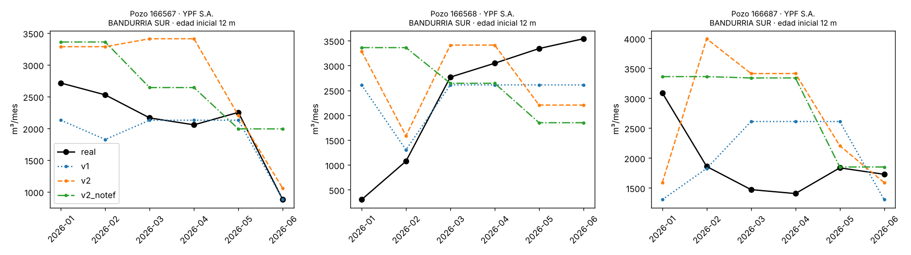

# Resultados de las pruebas y análisis

> **Estado:** completo con corridas reales del 11 y 12/11/2026 (k6 `RESULT`, eventos de Kubernetes y capturas de Grafana; respaldo en `backup/gke-20261112-2021`, fuera del repo). No se escriben números que no hayan salido de una corrida.

## 1. Arquitectura efectivamente usada

| Elemento | Valor |
|---|---|
| Proyecto / región / zona | `unlu-ia-boyer-lab-511417` / us-central1 / us-central1-a |
| Cluster | `tfvm-dev-gke`, zonal, canal REGULAR, versión `v1.36.4-gke.2377000` (creado por Terraform desde GitHub Actions en 11 min) |
| Node pool | e2-standard-2 (2 vCPU, 8 GB), disco 40 GB pd-standard, autoescalado 1–4 (nodos al inicio: 1; API, PostgreSQL y toda la observabilidad entraron en ese nodo) |
| Servicios desplegados | api (Deployment + HPA), postgres (StatefulSet + PVC 2 Gi), training (3 CronJobs), kube-prometheus-stack, Loki, Alloy |
| Recursos por pod de la API | requests 250m → **700m** (ver §3.2.3) / 384Mi, limits 1 CPU / 768Mi, 1 proceso uvicorn |
| HPA | 2–10 réplicas, CPU 60 % de la request, estabilización 0 s al subir y 120 s al bajar |
| Modelo | `DecisionTreeRegressor` (scikit-learn 1.5.2) en un pipeline con one-hot; artefactos joblib de 5 a 18 KB |
| Dónde se entrenó | Job en GKE (CronJob `training-<modelo>` con `tune: true`); las mismas métricas se obtuvieron en la PC y en k3d |
| Dataset | `vm_shale_202601_202606`, sha256 `04a1ebb3…b3b2d5`, 12.321 filas / 2.212 pozos, meses 2026-01–2026-06 |

## 2. Ciclo de entrenamiento

Corridas del 11/11/2026 sobre el snapshot `vm_shale_202601_202606` (sha256 `04a1ebb3…b3b2d5`): tabla 9 del ArcGIS, más el padrón (capa 0) y las trayectorias (capa 10) descargadas ese día. scikit-learn 1.5.2, Python 3.12. Se reproducen con `.\tasks.ps1 train-all` y con el notebook.

### 2.1 Datos

| Etapa | Registros | Pozos |
|---|---:|---:|
| Vaca Muerta · no convencional · shale | 18.857 | 3.278 |
| Petrolíferos | 13.295 | — |
| Petrolíferos en extracción efectiva (población) | **12.321** | **2.212** |

- Meses: 2026-01 a 2026-06. `prod_pet`: mediana 698 m³/mes, media 1.285, P99 8.038 y máximo 14.579; 1,6 % de registros en cero.
- **Edad del pozo:** el padrón (`FECHA_INIC`) da fecha para el 100 % de la población.
  - En los 201 pozos que empiezan a producir dentro del semestre, la primera producción llega una mediana de **7 meses** después de `FECHA_INIC` (P10 = 5). La fecha es, por lo tanto, el **inicio de la perforación**, y la variable se interpreta como "meses desde el inicio de la perforación".
  - El P90 de 117 meses corresponde a pozos viejos que no produjeron en enero y volvieron a producir después.
- **Largo horizontal** (capa 10): cubre el 52,3 % de la población.
- Concentración de la población: YPF tiene el 66,3 % de los registros, Vista el 11,2 % y Shell el 7,0 %. Por área: Loma Campana 27,1 %, La Amarga Chica 14,8 % y Bandurria Sur 9,5 %.

### 2.2 Reproducción del R² original (punto 1 de la devolución)

Mismos 12.321 registros del notebook de Colab, `DecisionTreeRegressor(max_depth=6, min_samples_leaf=20)`.

| Separación | MAE | RMSE | R² |
|---|---:|---:|---:|
| Por pozo, `GroupShuffleSplit(test_size=0.2, random_state=42)` (original) | 703,1 | 1.222,1 | **0,476** |
| Por pozo, semilla 42, árbol **sin** límites | 891,9 | 1.681,9 | 0,008 |
| Aleatoria por fila (mezcla meses de un pozo) | 639,7 | 1.128,3 | 0,511 |

- El 0,48 se reproduce cuando se usan `min_samples_leaf=20` y `max_depth=6`.
- Un árbol sin límites sobreajusta (R² ≈ 0), lo que probablemente explica la diferencia con la corrida del docente.
- Separar por fila infla el R² en 0,035 porque el modelo ve otros meses del mismo pozo.

### 2.3 Validación repetida (10 separaciones por pozo, 75/25, conjunto de desarrollo)

| Versión | Modelo | MAE (m³/mes) | RMSE | R² |
|---|---|---:|---:|---:|
| — | Predecir el promedio | 1.170 ± 29 | 1.686 ± 72 | 0,00 |
| v1 | Regresión lineal | 884 ± 19 | 1.393 ± 55 | 0,316 ± 0,021 |
| v1 | Árbol | 706 ± 35 | 1.233 ± 65 | 0,464 ± 0,040 |
| v2 | Regresión lineal | 799 ± 27 | 1.287 ± 70 | 0,415 ± 0,050 |
| v2 | Árbol | **513 ± 27** | 923 ± 68 | **0,699 ± 0,034** |
| v2_notef | Regresión lineal | 820 ± 28 | 1.326 ± 67 | 0,379 ± 0,049 |
| v2_notef | Árbol | 585 ± 34 | 1.059 ± 76 | 0,604 ± 0,039 |

- La variabilidad entre semillas es de unos ±0,04 de R², así que diferencias menores entre modelos no son concluyentes con una sola separación.
- **De v1 a v2:** el MAE baja un 27 % (de 706 a 513) y la diferencia es unas 7 veces el desvío entre semillas. La edad del pozo concentra el 71 % de la importancia del árbol v2; después vienen TEF (11 %) y profundidad (8 %).
- **Costo de no usar el TEF:** quitarlo (v2 → v2_notef) sube el MAE de 513 a 585 (+14 %). Aun así, v2_notef supera claramente a v1, que sí usa el TEF.

### 2.4 Holdout fijo (432 pozos, 20 %) y validación temporal

| Versión | MAE train | R² train | MAE holdout | R² holdout | Temporal, mismos pozos (MAE / R²) | Temporal, pozos nuevos (MAE / R²) |
|---|---:|---:|---:|---:|---:|---:|
| v1 | 654 | 0,526 | 696 | 0,465 | 652 / 0,483 | 751 / 0,449 |
| v2 | 450 | 0,767 | 493 | 0,721 | 519 / 0,635 | 535 / 0,708 |
| v2_notef | 488 | 0,708 | 588 | 0,605 | 591 / 0,528 | 644 / 0,592 |

- **Validación temporal:** se entrena con enero–abril (pozos de desarrollo) y se prueba con mayo–junio. Los resultados son del mismo orden que la validación por pozo, así que el modelo no depende de ver el mes a estimar.
- **Sobreajuste:** la brecha entre train y holdout es moderada (0,05 a 0,10 de R²).

### 2.5 Largo horizontal (capa 10)

| Versión | MAE | R² |
|---|---:|---:|
| v2 | 513 ± 27 | 0,699 ± 0,034 |
| v2 + largo horizontal | 515 ± 27 | 0,698 ± 0,033 |
| v2_notef | 585 ± 34 | 0,604 ± 0,039 |
| v2_notef + largo horizontal | 591 ± 37 | 0,601 ± 0,040 |

- La correlación de Spearman entre largo horizontal y producción es 0,38, pero **no mejora el modelo**.
- Motivos: solo cubre el 52 % de los pozos, y está correlacionado con la profundidad informada (ρ = 0,65; la profundidad parece incluir la rama horizontal) y con la edad (ρ = −0,41: los pozos nuevos son más largos).
- **No se incorpora.**

### 2.6 Versiones, tiempos y promoción

Hiperparámetros con `--tune`: grilla `max_depth` ∈ {4, 6, 8, 10, 12} × `min_samples_leaf` ∈ {5, 10, 20, 50}, con GroupKFold(5) sobre el conjunto de desarrollo.

| Versión | Parámetros | MAE holdout | CV MAE | Fit (s) | Total (s) | ¿Promovida? | Motivo (registrado en metadata.json) |
|---|---|---:|---:|---:|---:|---|---|
| v1 base | depth 6, leaf 20 | 696,5 | 706 ± 35 | 0,02 | 1,2 | Sí | No había versión vigente |
| v1 `--tune` | depth 6, leaf 5 | 698,9 | 709 ± 36 | 0,02 | 4,2 | No | Mejora −0,35 % < 1 % |
| v2 base | depth 8, leaf 20 | 492,7 | 513 ± 27 | 0,04 | 1,7 | Sí | No había versión vigente |
| v2 `--tune` | depth 10, leaf 5 | 490,2 | 512 ± 26 | 0,05 | 7,0 | No | Mejora 0,51 % < 1 % (IC 90 % [−15,8; 21,1] m³) |
| v2_notef base | depth 10, leaf 20 | 588,4 | 585 ± 34 | 0,05 | 1,7 | Sí | No había versión vigente |
| v2_notef `--tune` | depth 8, leaf 5 | 560,8 | 573 ± 29 | 0,04 | 6,1 | **Sí** | Mejora 4,69 %, IC 90 % [1,7; 54,2] m³ > 0 |
| v2_notef `--tune` (repetida) | depth 8, leaf 5 | 560,8 | 573 ± 29 | 0,04 | 6,1 | No | Mejora 0,00 % < 1 % |

- Los tiempos se midieron en el contenedor de desarrollo, no en GKE. Se completan con los Jobs de GKE (sección 1).
- Los artefactos pesan entre 5 y 18 KB.
- **Reproducibilidad entre entornos:** con el mismo snapshot (sha256 `04a1ebb3…`), `train-all -Tune` dio métricas idénticas en el contenedor de desarrollo, en la PC del autor (Windows, Python 3.12.10, ~4 s por modelo) y en un Job dentro de k3d con la imagen `training:local` (v2_notef: MAE 560,8, R² 0,635, CV 572,6 ± 29,0; 10,7 s en total incluyendo la conexión a PostgreSQL). La corrida en k3d no se promovió (mejora 0,00 % < 1 %) y quedó registrada en la tabla `training_runs`.
- **Punto 4 de la devolución:** reentrenar exactamente la misma configuración **no** promueve una versión nueva. La evaluación es sobre el mismo holdout fijo y la versión vigente se re-evalúa con el dataset actual. Una mejora pequeña (v2 con `--tune`, 0,5 %) tampoco se promueve, porque su intervalo bootstrap incluye el cero.

### 2.7 Declinación (punto 3)

Pozos del holdout con los 6 meses en la población (341 pozos), cambio entre el primer y el último mes:

| Modelo | Grupo | Pozos | Cambio real (mediana) | Cambio estimado (mediana) | Pozos con estimación constante |
|---|---|---:|---:|---:|---:|
| v1 | Todos | 341 | −12,5 % | 0,0 % | 55,7 % |
| v1 | Jóvenes (≤ 24 meses al inicio) | 82 | −30,1 % | 0,0 % | 35,4 % |
| v2 | Todos | 341 | −12,5 % | 0,0 % | 49,3 % |
| v2 | Jóvenes | 82 | −30,1 % | **−27,4 %** | 17,1 % |
| v2_notef | Jóvenes | 82 | −30,1 % | −20,1 % | 30,5 % |



- Con la edad del pozo, v2 **sigue la declinación de los pozos jóvenes**: estima −27 % frente al −30 % real, cuando v1 quedaba plano en todos.
- En los pozos maduros, que declinan más lento, el árbol sigue asignando los 6 meses a la misma hoja y la estimación queda constante. Es una limitación estructural de un árbol con hojas de ≥ 5 a 20 registros.
- La figura también muestra **subidas** al inicio de la producción (pozo 166568): el pozo empieza a producir unos 6 meses después de la perforación y tarda en estabilizarse. Ningún modelo capta ese tramo.

## 3. Servicio de inferencia

### 3.0 Validación local en k3d (11/11/2026)

Antes de GKE se validó el circuito completo en la PC del autor (Windows 11, 8 GB de RAM, Docker Desktop, k3d v5.9.0 con k3s v1.35.5, 1 server + 1 agent). La API corrió con requests 100m/256Mi y HPA 1–4 (`values-k3s.yaml`), y PostgreSQL con un PVC `local-path` de 2 Gi.

| Prueba | Resultado |
|---|---|
| `/healthz` | `ok` tras cargar las 3 versiones vigentes desde `/artifacts` (hostPath) |
| `/models` | v1 `v1-20261111T212728`, v2 `v2-20261111T212736`, v2_notef `v2_notef-20261111T212741`; sin errores de carga; 3.278 pozos indexados |
| Entrenamiento en el cluster | Job desde el CronJob `training-v2-notef`: mismas métricas, no promovido, run registrado en PostgreSQL |
| Carga (k6 en el cluster, 10 VUs, 1 min) | 7.567 pedidos, **100,7 req/s**, p50 76 ms, p95 **168 ms**, p99 231 ms, máx. 3.319 ms, **0 % errores** |
| HPA | Escaló de 1 a 4 réplicas (el máximo) durante la prueba; al terminar la CPU bajó al 3 % |
| Registro de predicciones | `/stats` informó 7.568 predicciones de `v2_notef-20261111T212741` en PostgreSQL (las de k6 más una manual) |

- El máximo de 3,3 s coincide con el escalado: los pods nuevos reciben tráfico mientras el nodo está saturado (k3d corre en la misma PC que k6 y Docker Desktop). En GKE se separa ese efecto midiendo con réplicas fijas.
- Durante la validación aparecieron y se corrigieron dos detalles de presentación: el JSON no declaraba `charset=utf-8` (PowerShell 5.1 mostraba mal los acentos), y la nota "tef supuesto" aparecía también en v2_notef, que no usa TEF.

### 3.0.1 Caso de inferencia comentado: pozo 166692 (holdout)

El pozo 166692 (YPF, La Angostura Sur I, surgencia natural, profundidad 6.641 m, primera producción 2024-10) pertenece al holdout (hash 10 < 20): ningún modelo lo vio al entrenar. `GET /wells/166692`:

| Mes | Real (m³) | TEF | v1 | v2 | v2_notef |
|---|---:|---:|---:|---:|---:|
| 2026-01 | 5.664 | 31 | 3.476,3 | 4.151,0 | 3.386,6 |
| 2026-02 | 4.678 | 28 | 3.476,3 | 3.319,7 | 3.386,6 |
| 2026-03 | 4.960 | 31 | 3.476,3 | 3.319,7 | 3.386,6 |
| 2026-04 | 4.141 | 29 | 3.476,3 | 3.319,7 | 3.386,6 |
| 2026-05 | 4.502 | 31 | 3.476,3 | 2.967,8 | 2.247,9 |
| 2026-06 | 4.258 | 30 | 3.476,3 | 2.967,8 | 2.247,9 |
| **MAE del pozo** | | | **≈ 1.225** | **≈ 1.360** | **≈ 1.693** |

`POST /predict {"idpozo": 166692}` (v2_notef, julio 2026) devolvió **2.247,9 m³**, sin categorías no vistas ni valores fuera de rango.

- Es un pozo de alta producción (≈ 4.700 m³/mes contra una mediana de 698) y los tres modelos lo **subestiman**: el árbol lo ubica en hojas con pozos parecidos pero menos productivos.
- **Salto escalonado:** al pasar de 18 a 19 meses de edad (mayo), v2_notef cambia de hoja y la estimación cae un 34 %, mientras la producción real baja de forma gradual. Es la limitación estructural del árbol descripta en §2.7.
- v1 queda mejor en este pozo, aunque en el holdout completo es claramente peor (MAE 696 contra 561). Un caso aislado ilustra el comportamiento pero no reemplaza la métrica global.

### 3.1 Metodología

- k6 dentro del cluster (`loadtest/k6-job.yaml`): la carga llega al Service y se reparte entre las réplicas.
- Carga **cerrada**: N usuarios virtuales sin pausa, es decir, N peticiones concurrentes. Subida de 15 s y meseta de 2 min.
- Cada petición es `POST /predict {"idpozo": <al azar entre 500 pozos>}` con el modelo por defecto (`v2_notef`).
- Réplicas fijas: `.\tasks.ps1 replicas -Replicas N` (quita el HPA). Autoescalado: reinstalar el chart (HPA 2–10).
- Por corrida se guarda `results\k6-<contexto>-<label>.log` y una captura del dashboard.

Comandos de la matriz:

```powershell
foreach ($r in 1,3,5) {
  .\tasks.ps1 replicas -Replicas $r
  foreach ($v in 1,10,50,100) { .\tasks.ps1 loadtest -Vus $v -Duration 2m -Label "r$r-vus$v" }
}
# HPA 2-10: reinstalar el chart api (deploy.yml con charts=api) y luego
foreach ($v in 1,10,50,100,150) { .\tasks.ps1 loadtest -Vus $v -Duration 3m -Label "hpa-vus$v" }
```

### 3.2 Réplicas fijas

Corridas del 11/11/2026 en GKE (1 nodo e2-standard-2 al inicio; k6 2.3.0 como Job en el mismo cluster; 2 min de meseta por corrida; `POST /predict` con el modelo por defecto). Valores de las líneas `RESULT` (`results/k6-gke_…-<label>.log`).

#### 3.2.1 Hallazgo: sondas de salud que tumban la réplica saturada (imagen `14d68a6`)

| Corrida | VUs | RPS | p50 | p95 | p99 | Máx. | Errores |
|---|---:|---:|---:|---:|---:|---:|---:|
| r1-vus1 | 1 | 62,2 | 13,5 ms | ≈ 28 ms | 40,7 ms | 205 ms | 0 % |
| r1-vus10 | 10 | 58,5 | 144 ms | 297 ms | 492 ms | 1.937 ms | 0 % |
| r1-vus50 | 50 | 94,7* | — | 1.073 ms | 1.512 ms | 3.072 ms | **52,7 %** |

\* Incluye respuestas fallidas inmediatas (conexión rechazada), por eso el RPS "sube".

Secuencia (eventos de Kubernetes): con 50 VUs sobre una réplica saturada, `/livez` superó el timeout de 1 s de la sonda (*context deadline exceeded*), Kubernetes **reinició el pod** (*failed liveness probe, will be restarted*) y durante el reinicio no hubo ninguna réplica disponible (*connection refused*, *i/o timeout*). El panel "Réplicas de la API" muestra el bache a 0 disponibles.

Causa: `/livez` y `/healthz` eran funciones síncronas y hacían cola en el mismo pool de threads que `/predict`; con la CPU saturada, la sonda esperaba detrás de las predicciones. Corrección (commit `2565ebb`): sondas y `/metrics` como `async def` (se atienden en el event loop), readiness con timeout de 3 s y liveness tolerante (timeout 5 s × 6 intentos ≈ 1 min). **Lección:** una sonda de liveness agresiva convierte una saturación (latencia alta) en una caída (errores), justo cuando más se necesita la réplica.

#### 3.2.2 1 réplica, sondas corregidas (imagen `2565ebb`)

| Réplicas | VUs | RPS | p50 (ms) | p95 (ms) | p99 (ms) | Máx. (ms) | Errores | CPU del pod (Grafana) |
|---:|---:|---:|---:|---:|---:|---:|---:|---|
| 1 | 1 | 60,5 | 14,0 | 29,1 | 42,0 | 161 | 0 % | ≈ 0,9 núcleos |
| 1 | 10 | 62,1 | 142,9 | 262,5 | 374,6 | 642 | 0 % | ≈ 0,9 |
| 1 | 50 | 58,0 | 796,4 | 1.200,2 | 1.783,4 | 2.338 | 0 % | ≈ 0,9 |
| 1 | 100 | 54,1 | 1.704,2 | 2.544,2 | 3.218,9 | 3.937 | 0 % | ≈ 0,9 |

- **Techo de una réplica ≈ 60 req/s.** Con un solo VU (peticiones en serie) ya se alcanza: cada predicción cuesta ≈ 15 ms de CPU, dominados por armar el DataFrame de pandas y el preprocesamiento, no por el árbol.
- Por encima del techo, más VUs solo agregan **espera en cola**: la latencia crece en proporción (ley de Little: 100 VUs ÷ 54 req/s ≈ 1,85 s, contra un p50 medido de 1,70 s).
- Con las sondas corregidas, **0 % de errores aun con 100 VUs**: la réplica atiende lento pero no se cae.

#### 3.2.3 3 réplicas en un solo nodo (requests de 250m)

| Réplicas | VUs | RPS | p50 (ms) | p95 (ms) | p99 (ms) | Máx. (ms) | Errores | CPU por pod (Grafana) |
|---:|---:|---:|---:|---:|---:|---:|---:|---|
| 3 | 10 | 48,5 | 156,6 | 469,3 | 752,3 | 1.223 | 0 % | ≈ 0,43 |
| 3 | 50 | 45,1 | 933,9 | 2.083,6 | 2.803,8 | 3.803 | 0 % | ≈ 0,43 |
| 3 | 100 | 53,9 | 1.720,2 | 2.770,1 | 3.576,7 | 4.331 | 0 % | ≈ 0,43 |

- **Tres réplicas rindieron menos que una.** La API pedía 250m de CPU pero usa ≈ 0,9 núcleos bajo carga: el scheduler ubicó las 3 réplicas en el único nodo (2 vCPU, compartido con la observabilidad y con k6) y, como "entraban", el autoescalador de nodos no agregó ninguno. Cada pod quedó con ≈ 0,43 núcleos (≈ 1,3 en total).
- **Corrección** (commit `4ea251c`): request de CPU de la API = **700m**, cercano al consumo real (entran 2 réplicas por nodo e2-standard-2 y los pods que no entran obligan a GKE a sumar nodos); k6 reserva 500m.
- Pendiente: repetir 3 y 5 réplicas con 700m (§3.2.4) y el HPA (§3.3).

#### 3.2.4 3 y 5 réplicas con requests de 700m (12/11/2026, imagen `2565ebb`, chart de `f047c59`)

| Réplicas | VUs | RPS | p50 (ms) | p95 (ms) | p99 (ms) | Máx. (ms) | Errores | Nodos |
|---:|---:|---:|---:|---:|---:|---:|---:|---|
| 3 | 1 | 78,6 | 11,5 | 17,4 | 25,7 | 141 | 0 % | 2 (2 + 1 réplicas) |
| 3 | 10 | **179,6** | 42,3 | **105,9** | 156,5 | 622 | 0 % | 2 |
| 3 | 50 | 165,9 | 278,1 | 457,9 | 572,6 | 943 | 0 % | 2 |
| 3 | 100 | 157,1 | 592,7 | 921,3 | 1.119,0 | 1.637 | 0 % | 2 |
| 5 | 1 | 57,8 | 14,0 | 32,6 | 50,3 | 341 | 0 % | 3 (2 + 2 + 1) |
| 5 | 10 | 231,3 | 17,7 | 135,1 | 209,4 | 790 | 0 % | 3 |
| 5 | 50 | **248,5** | 179,2 | **330,9** | 472,2 | 1.103 | 0 % | 3 |
| 5 | 100 | 226,4 | 355,3 | 875,4 | 1.177,9 | 2.008 | 0 % | 3 |

Comparación con 1 réplica (§3.2.2), mismo número de usuarios:

| VUs | 1 réplica | 3 réplicas (700m) | 5 réplicas (700m) |
|---:|---|---|---|
| 10 | 62,1 req/s · p95 263 ms | 179,6 · 106 ms (×2,9) | 231,3 · 135 ms (×3,7) |
| 50 | 58,0 · 1.200 ms | 165,9 · 458 ms (×2,9) | 248,5 · 331 ms (×4,3) |
| 100 | 54,1 · 2.544 ms | 157,1 · 921 ms (×2,9) | 226,4 · 875 ms (×4,2) |

- Con CPU real disponible, **3 réplicas rinden ≈ 3 veces** lo que una (cada pod ≈ 0,86–0,98 núcleos, captura 7.5b). Frente a §3.2.3 (las mismas 3 réplicas en un solo nodo) el throughput pasó de ≈ 50 a ≈ 180 req/s y el p95 con 100 VUs de 2,8 s a 0,9 s.
- **5 réplicas escalan, pero menos que proporcional** (×4,1–4,3 en lugar de ×5): dos nodos alojaban 2 réplicas cada uno y k6 compartía nodo con la API. Cada pod igual usaba ≈ 0,85–0,93 núcleos; el límite probable es la CPU de los nodos compartidos o el propio k6 (limitado a 1 núcleo). Queda como hipótesis: no se midió por separado.
- **Con 1 VU más réplicas no ayudan:** las peticiones son en serie y van a una réplica por vez. El 78,6 req/s con 3 réplicas frente a 60 req/s en la corrida de 1 réplica refleja que k6 ya no competía por CPU con la API (reserva de 500m).
- Con 100 VUs el p95 deja de mejorar entre 3 y 5 réplicas (921 → 875 ms): por encima de ≈ 250 req/s el sistema ya está en su techo con esta cantidad de nodos.
- `k6-r3b-vus100` y `k6-r5-vus100` terminaron como `Failed`: k6 sale con código de error cuando se cruzan los umbrales del script (p95 > 500 ms), no por errores HTTP (0 %).

### 3.3 Autoescalado (HPA 2–10, objetivo 60 % de CPU, requests de 700m)

Dos corridas con la misma carga (150 VUs, 4 min) partiendo de 2 réplicas. La diferencia es cómo k6 reutiliza las conexiones TCP.

| Corrida | Conexiones | Pedidos | RPS medio | Pico (Grafana) | p50 | p95 | Errores | Réplicas pedidas | Réplicas disponibles | Nodos |
|---|---|---:|---:|---:|---:|---:|---:|---:|---:|---:|
| `hpa-vus150` | keep-alive (default) | 33.542 | 131,3 | ≈ 133 | 1.093 ms | 1.520 ms | 0 % | 5 | 5 | 2 → 4 |
| `hpa-noreuse-b` | una por pedido (`-NoReuse`) | 63.370 | **247,7** | **295** | **255 ms** | 1.962 ms | 0 % | **10** (máximo) | 7 | 4 (máximo) |

Secuencia de la segunda corrida (eventos `SuccessfulRescale` de `kubectl describe hpa api`, captura 7.6b, horas reconstruidas desde su antigüedad, ±10 s):

| Hora | Réplicas | Motivo |
|---|---|---|
| 20:02:00 | 3 → 5 | CPU sobre el objetivo |
| 20:02:15 | 5 → 6 | |
| 20:02:29 | 6 → 8 | |
| 20:02:43 | 8 → **10** | máximo, ≈ 45 s después del primer escalado |
| ≈ 20:06 | | termina la carga |
| 20:07:39 | 10 → 4 | CPU bajo el objetivo, tras la ventana de 120 s |
| 20:07:54 | 4 → **2** | mínimo |

#### 3.3.1 Hallazgo: con keep-alive, las réplicas nuevas no reciben tráfico

En `hpa-vus150` el HPA subió a 5 réplicas y GKE agregó 2 nodos (captura 7.6a), pero el throughput quedó plano en ≈ 130 req/s: las 2 réplicas originales trabajaron a ≈ 0,95 núcleos y las 3 nuevas casi a 0 (captura 7.7a). k6 abre una conexión TCP por usuario virtual y la reutiliza; un Service de Kubernetes (kube-proxy) reparte **conexiones**, no pedidos, así que las 150 conexiones quedaron fijadas a los 2 pods que existían al empezar. El promedio de CPU que ve el HPA ((2 × 135 % + 3 × ≈ 0 %) / 5 ≈ 54 %) quedó bajo el 60 % y el HPA se detuvo en 5.

Con una conexión por pedido (`-NoReuse`), cada pedido se reparte entre todas las réplicas: el throughput se duplicó, el p50 bajó a la cuarta parte y el HPA fue hasta 10. El p95 más alto (1.962 ms) refleja el primer tramo con 2 réplicas y el costo de abrir una conexión por pedido.

Conclusión: el HPA solo ayuda si el balanceo reparte **pedidos**. Con clientes que mantienen conexiones largas hace falta un balanceador de capa 7 (Ingress HTTP, gateway o service mesh) o limitar la vida de las conexiones del lado del servidor.

#### 3.3.2 Hallazgo: el tope del node pool limita al HPA (pods `Pending`)

Con el HPA en 10, 3 a 4 réplicas quedaron en `Pending` (capturas 7.9b1–3 y 7.8). Los eventos de cada pod son los mismos:

- `FailedScheduling`: *0/4 nodes are available: 4 Insufficient cpu.*
- `NotTriggerScaleUp` (cluster-autoscaler): *Pod didn't trigger scale-up: 1 max node group size reached.*

La causa es **falta de CPU reservable en los nodos** con el autoescalador de nodos ya en su máximo (4 nodos e2-standard-2): cada nodo tiene ≈ 1,9 núcleos asignables, de los que el sistema y la observabilidad usan una parte; entran ≈ 6–7 réplicas de 700m. Para 10 réplicas harían falta ≈ 6 nodos (o nodos más grandes). El mismo efecto dejó al pod de k6 en `Pending` 2,5 min (captura 7.8) hasta que el HPA bajó réplicas y liberó CPU.

#### 3.3.3 Tiempos de reacción

- **HPA al subir:** de 3 a 10 réplicas en ≈ 45 s, en saltos cada ≈ 15 s (política por defecto: hasta 4 pods o 100 % cada 15 s, visible en `describe hpa`).
- **Disponibilidad real:** en `hpa-vus150` las réplicas pedidas tardaron ≈ 2,5 min en estar disponibles porque GKE tuvo que crear 2 nodos (≈ 70 s), descargar la imagen y cargar los modelos. El escalado de pods es rápido; el de nodos domina.
- **HPA al bajar:** espera la ventana de 120 s configurada y vuelve al mínimo en dos pasos (10 → 4 → 2 en 15 s).
- **Autoescalador de nodos al bajar:** retira los nodos sobrantes ≈ 10 min después; al hacerlo reubica pods y corta los `port-forward` (pasó con el túnel de Grafana).

### 3.4 Análisis

- **Saturación de una réplica:** ≈ 60 req/s por réplica (un proceso uvicorn, ≈ 15 ms de CPU por predicción, dominados por pandas y el preprocesamiento). A partir de ahí la latencia crece solo por espera en cola (ley de Little). El docente midió ≈ 200 rps por proceso con un modelo más liviano; aquí cada pedido arma un DataFrame y aplica el pipeline completo.
- **Escalado:** casi lineal hasta 3 réplicas (×2,9) y sublineal con 5 (×4,2), siempre que cada réplica tenga CPU propia. Con requests de 250m el scheduler apiló 3 réplicas en un nodo y rindieron menos que una (§3.2.3).
- **Justificación del HPA:** el request debe reflejar el consumo real (≈ 0,9 núcleos bajo carga → 700m) para que el scheduler reparta y el autoescalador de nodos actúe. Con 700m, el objetivo del 60 % (≈ 420m) dispara el escalado antes de que una réplica sature. El tope real lo pone el node pool (4 nodos).
- **Alerta `PredictLatenciaP95Alta`:** no se disparó en ninguna prueba. Usa la latencia medida **dentro** del servidor (p95 ≈ 120–320 ms), que no incluye la espera en cola antes de que la réplica tome el pedido; la latencia que percibe el cliente (k6) llegó a 1,5–2,5 s. Para producción la alerta debería basarse en la latencia medida en el balanceador/Ingress o en una sonda sintética.
- **Errores:** 0 % en todas las corridas con la configuración final. El único episodio con errores (52,7 %) fue la sonda de liveness reiniciando una réplica saturada (§3.2.1), corregido.
